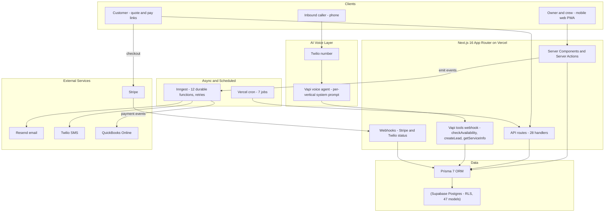

# ServiceLedger

> The AI that answers your phone and runs your crew — a field-ops platform that takes service businesses from quote to cash.

**Role:** Solo founder & full-stack engineer (product, architecture, code, infra) · **Timeframe:** 2026 – Present (ongoing) · **Status:** Live in production · **Live:** [getserviceledger.com](https://www.getserviceledger.com)

---

## The Problem

Owner-operators in the trades — cleaning, landscaping, plumbing, pressure washing, handyman — run their entire business from a phone with dirt on their boots. They miss calls while they are on a ladder, lose quotes in text threads, and chase payments by hand. Existing field-service software is built for office dispatchers and bills like enterprise accounting suites, so it never fits a one-truck operation. ServiceLedger answers the phone for them and runs the whole job lifecycle — quote → schedule → invoice → collect — from a single mobile-first app.

## What I Built

- **AI phone agent (Vapi):** answers inbound calls on a Twilio number, speaks a system prompt generated per business vertical, and uses real-time tool calls to check live crew availability, create leads, and quote service info — then books the job without the owner lifting a finger.
- **Quote → cash core loop:** a quote builder with tiered pricing and one-tap customer approval, drag-and-drop crew dispatch, before/after photo proof, Stripe invoices with payment links, and automated SMS/email payment follow-up.
- **Money engine built for trust:** every amount stored as integer cents, every multi-row money operation wrapped in a Prisma transaction, and an immutable `LedgerEntry` event log behind an idempotent Stripe webhook.
- **Automated back office:** 12 durable Inngest background functions and 7 Vercel cron jobs handle recurring-job generation, payment reminders, quote expiry, daily briefing emails, and phone-usage overage billing.
- **Deep integrations:** Stripe payments, Twilio SMS + number provisioning, Resend email, QuickBooks Online one-way sync, Google Places address autocomplete, and server-side PDF generation for quotes and signed proposals.
- **Multi-tenant from the ground up:** every table is scoped by `organizationId` with Supabase Row Level Security as a safety net, role-based access (owner vs. employee), and Upstash rate limiting on sensitive routes.

## Architecture

Every request path — web UI, AI phone tools, and webhooks — resolves through the same server layer into a single Prisma/Postgres tenant boundary, so multi-tenant isolation is enforced in exactly one place. All email, SMS, and QuickBooks sync are offloaded to Inngest with retries rather than run inline, keeping server actions fast and side-effects durable. Scheduled work (reminders, recurring jobs, briefings, overage billing) runs as Vercel cron hitting dedicated API routes.

## Tech Stack

Only what the repo actually uses, grouped by layer.

**Web**
- Next.js 16.3 (App Router, React Server Components + Server Actions — no client-side data fetching)
- React 19 · TypeScript 6 (strict)
- Tailwind CSS 4 · shadcn/ui + Base UI · Lucide · Sonner
- React Hook Form + Zod 4 · TipTap (proposal rich text) · dnd-kit (dispatch board)

**Data**
- Supabase Postgres · Prisma 7.10 ORM (`@prisma/adapter-pg`, driver adapters)
- 47 models / 23 enums · Supabase Auth + Storage

**AI / Voice**
- Vapi voice agent with a per-vertical system-prompt builder and real-time function tools for availability and booking

**Platform**
- Stripe (invoices, payment links, webhooks) · Twilio (SMS + number provisioning)
- Resend (transactional email) · Inngest (12 durable background functions)
- Upstash Redis (rate limiting) · QuickBooks Online (OAuth sync)
- Puppeteer + pdf-lib (server-side PDF) · PapaParse (CSV import)
- Vercel (hosting + 7 cron jobs)

**Security & Observability**
- Supabase Row Level Security on all tables + app-layer `organizationId` filtering (defense in depth)
- Role-based access (OWNER / EMPLOYEE) · Upstash rate limiting · CSP reporting · gitleaks secret scanning
- Sentry (with PII scrubbing) · Mixpanel · LogRocket

## Highlights / Results

- **Solo build, production-grade surface area:** 47 Prisma models, 54 server-action modules, 28 API route handlers, and 44 domain modules under `lib/` — all designed, built, and shipped by one person.
- **157 automated tests** (152 Vitest unit/integration + 5 Playwright E2E), including a multi-tenant `org-isolation` E2E test, transaction `atomicity-rollback` integration tests against a real database, and dedicated money-math and ledger-integrity suites.
- **Money correctness as a first-class concern:** integer-cents everywhere, Prisma `$transaction` around every multi-row financial write, an append-only `LedgerEntry` audit trail, and an idempotent Stripe webhook keyed on `stripePaymentIntentId` to survive provider retries.
- **Opinionated data-fetching architecture:** server components + server actions only — no `useEffect` fetching, no React Query, no client store — which keeps the mobile app fast and the data layer easy to reason about.
- **AI agent that does real work, not demos:** the Vapi tool webhook resolves actual crew availability and writes real leads into the tenant's database, with the assistant's prompt tailored to each business vertical.
- **Operational maturity:** durable background jobs with retries, 7 scheduled crons, phone-usage overage metering and billing, Sentry monitoring with PII scrubbing, and a documented `SECURITY.md` + pre-commit secret scanning.

## Screenshots

> Add real captures to `assets/` — replace the placeholders below. GIFs of the AI call flow and the quote → pay loop land hardest with recruiters.

| | |
|---|---|
|  |  |
|  |  |
|  |  |

*ServiceLedger is the public brand; the codebase is named ServiceBooks internally.*
